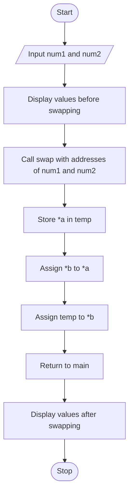

# Swapping-Two-Numbers-Using-Pointers-in-C


# Assignment 8: Swapping Two Numbers Using Pointers in C

## 1. Problem Statement

Write a C program to swap two numbers using pointers and understand the concepts of pointers, call by value, and call by reference.

## 2. Objectives

- To learn and understand pointers in C.
- To understand the declaration and initialization of pointers.
- To learn how to access and modify variables using pointers.
- To understand the concepts of call by value and call by reference.
- To implement a function that swaps two numbers using pointers.

## 3. Theory

### What is a Pointer?

A pointer is a variable that stores the memory address of another variable. Pointers allow a program to access and modify data indirectly through memory addresses.

**Syntax:**

```c
data_type *pointer_name;
```

**Example:**

```c
int num = 10;
int *ptr = &num;
```

In this example:

- `num` is an integer variable storing the value `10`.
- `&num` gives the memory address of `num`.
- `ptr` is a pointer that stores the address of `num`.
- `*ptr` accesses the value stored at the address held by `ptr`.

The `&` operator is called the **address-of operator**, while the `*` operator is used to declare a pointer and dereference it.

### Use of Pointers in C Programming

Pointers are useful in several areas of C programming:

- **Modifying variables:** Functions can modify variables in the calling function by receiving their addresses.
- **Passing arrays to functions:** Pointers allow functions to work with array elements.
- **Dynamic memory allocation:** Pointers are used with functions such as `malloc()` and `free()`.
- **Working with structures:** Pointers can access structure members using the arrow (`->`) operator.
- **Efficient data handling:** Pointers allow direct access to existing objects without copying the entire object.

### What is Call by Value?

Call by value means that a function receives a copy of the value passed to it. Changes made to the parameter inside the function do not change the original variable in the calling function.

**Example:**

```c
#include <stdio.h>

void change(int x) {
    x = 100;
}

int main() {
    int num = 10;

    change(num);

    printf("%d", num);

    return 0;
}
```

**Output:**

```text
10
```

The value remains `10` because the function modifies only its local copy of the variable.

### What is Call by Reference?

Call by reference is a technique in which a function receives access to the original variable so that modifications made through that access affect the original value.

C technically uses **call by value for all function arguments**. Reference-like behavior is achieved by passing pointers, which are copies of memory addresses.

**Example:**

```c
#include <stdio.h>

void change(int *x) {
    *x = 100;
}

int main() {
    int num = 10;

    change(&num);

    printf("%d", num);

    return 0;
}
```

**Output:**

```text
100
```

Here, `&num` passes the address of `num`, and `*x = 100` modifies the original variable through that address.

### How Does Swapping Using Pointers Work?

Swapping means exchanging the values of two variables.

Suppose:

```text
First number = 45
Second number = 63
```

After swapping:

```text
First number = 63
Second number = 45
```

A temporary variable can be used to exchange the values without losing either original value.

**Example:**

```c
void swap(int *a, int *b) {
    int temp;

    temp = *a;
    *a = *b;
    *b = temp;
}
```

When the function is called using `swap(&num1, &num2)`, the pointers receive the addresses of the original variables. Dereferencing the pointers allows the function to exchange their values directly.

## 4. Algorithm

1. Start the program.
2. Declare two integer variables to store the numbers.
3. Accept the first and second numbers from the user.
4. Display both numbers before swapping.
5. Call the `swap()` function and pass the addresses of both variables.
6. Receive the addresses using two pointer parameters.
7. Store the value of the first number in a temporary variable.
8. Assign the value of the second number to the first number.
9. Assign the temporary value to the second number.
10. Return control to the calling function.
11. Display both numbers after swapping.
12. Stop the program.

## 5. C Program

```c
#include <stdio.h>

void swap(int *a, int *b) {
    int temp;

    temp = *a;
    *a = *b;
    *b = temp;
}

int main() {
    int num1, num2;

    printf("Enter the first number: ");
    scanf("%d", &num1);

    printf("Enter the second number: ");
    scanf("%d", &num2);

    printf("\nBefore Swapping:\n");
    printf("First number = %d, Second number = %d\n",
           num1, num2);

    swap(&num1, &num2);

    printf("\nAfter Swapping:\n");
    printf("First number = %d, Second number = %d\n",
           num1, num2);

    return 0;
}
```

### Explanation of the Program

- `int *a, int *b`: Declares two pointer parameters that can store the addresses of integer variables.
- `swap(&num1, &num2)`: Passes the addresses of the two original variables to the function.
- `temp = *a`: Saves the value of the first variable.
- `*a = *b`: Copies the second variable's value into the first variable.
- `*b = temp`: Copies the saved original value of the first variable into the second variable.

The values are exchanged because the function modifies the original variables through their addresses.

## 6. Sample Input and Output

### Operation: Swap Two Numbers

**Input:**

```text
Enter the first number: 45
Enter the second number: 63
```

**Output:**

```text
Before Swapping:
First number = 45, Second number = 63

After Swapping:
First number = 63, Second number = 45
```

### Example: Swapping Two Other Numbers

**Input:**

```text
Enter the first number: 10
Enter the second number: 25
```

**Output:**

```text
Before Swapping:
First number = 10, Second number = 25

After Swapping:
First number = 25, Second number = 10
```

## 7. Flowchart



## 8. FAQs

### Q1. In C, why is a void pointer useful?

A void pointer (`void *`) is a generic pointer that can hold the address of an object of any data type.

It is useful when writing generic functions that work with different data types, such as memory allocation and certain library functions.

**Example:**

```c
int num = 10;
void *ptr = &num;

printf("%d", *(int *)ptr);
```

**Output:**

```text
10
```

A void pointer must be converted to an appropriate object pointer type before it can be dereferenced in standard C.

### Q2. What is a NULL pointer?

A NULL pointer is a pointer that is guaranteed not to point to a valid object or function. It is commonly used to indicate that a pointer does not currently refer to an object.

**Example:**

```c
int *ptr = NULL;
```

A NULL pointer must not be dereferenced. Doing so results in undefined behavior.

### Q3. What is the difference between `&` and `*` operators?

- `&` is the address-of operator. It returns the address of a variable.
- `*` is used to declare a pointer and to dereference a pointer, accessing the value stored at the pointed-to address.

For example:

```c
int num = 10;
int *ptr = &num;
```

Here, `&num` gives the address of `num`, while `*ptr` accesses its value, which is `10`.

### Q4. What is the difference between call by value and pointer-based reference behavior?

In call by value, a function receives a copy of the argument's value, so modifying the parameter does not modify the original variable.

In pointer-based reference behavior, a function receives a copy of the variable's address. By dereferencing that pointer, it can modify the original variable.

### Q5. Why is a temporary variable used while swapping two numbers?

A temporary variable preserves one value while the other value is being replaced. Without it, the original value could be lost during the exchange.

For example:

```c
temp = *a;
*a = *b;
*b = temp;
```

These three statements exchange the two values safely.

## 9. Conclusion

Thus, a C program was implemented successfully to swap two numbers using pointers. This experiment helped develop an understanding of pointer declaration, address and dereference operators, and the difference between call by value and pointer-based reference behavior. It also demonstrated how pointers enable a function to modify the original variables in the calling function.

